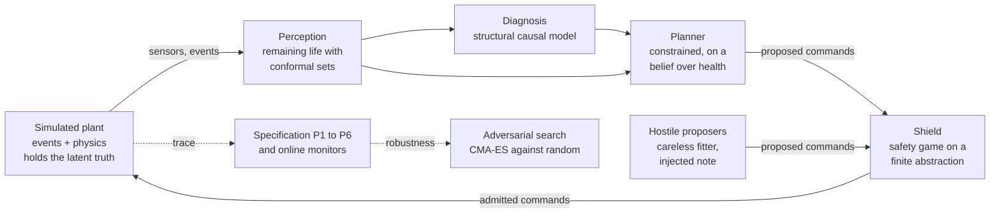

# closed-loop: a maintenance stack tested as one loop, on a simulated plant that keeps the truth

[](https://github.com/darrshangovender/closed-loop/actions/workflows/tests.yml)
[](LICENSE)
[](https://python.org)
[](docs/PREREGISTRATION.md)

> Conformal remaining-life intervals, causal diagnosis, a planner and a model-checked safety shield, run as one loop on a simulated plant, attacked on held-out seeds under a pre-registration, and published with what still gets through.

## Why this exists

Predictive maintenance, document assistants and supervised agents are often validated one at a time, on data the component did not influence. Closing the loop changes that. A repair ends the failure the estimator would have learned from, an alert changes what breaks next, and an agent's work order changes the data behind the next alert.

So the question here is what survives contact with the loop, and the simulator is what makes that measurable: it holds the latent truth, so a gap between open-loop and closed-loop behaviour can be read off directly. It also joins three repositories that were built separately, [asset-health](https://github.com/darrshangovender/asset-health), [plant-copilot](https://github.com/darrshangovender/plant-copilot) and [maintenance-agent](https://github.com/darrshangovender/maintenance-agent), and puts them in one loop for the first time: asset-health and maintenance-agent run in it, and plant-copilot's output enters through caches that the tests recompute with its real code.

Everything here is synthetic. No real plant, sensor stream or work order is involved. The claims were fixed in [docs/PREREGISTRATION.md](docs/PREREGISTRATION.md) before the first run on held-out seeds, and a claim that lost stays in the table below at the same size as one that won.

## Quick start

```bash
git clone https://github.com/darrshangovender/closed-loop && cd closed-loop
python -m venv .venv && source .venv/bin/activate        # Windows: .venv\Scripts\activate
pip install -e ".[dev]"

python examples/hostile_episode.py     # two simulated episodes on one seed, shield off then on
python benchmarks/run.py --quick       # the whole pipeline on development seeds; no ledger entry
python benchmarks/run.py --check       # compares the hashes in the ledger with this checkout
```

Nothing needs an API key or a network once installed. On an old laptop with two cores and four threads, the example took under a minute and a half, and `--quick` took about ten minutes in one run and about twenty minutes of work in a clean install while other work ran on the laptop. `--quick` writes its report to `benchmarks/.cache/quick-output/` under a banner saying it is not a result, and adds nothing to the ledger.

`python benchmarks/run.py --full` regenerates the published numbers from the held-out seeds and appends to the ledger. It took nine to eleven hours on that laptop, which was also doing other work. Finished episodes are cached, so it resumes after a stop. The F2 stage needs the sibling repositories (`pip install -e ".[integration]"`). Without them it skips with a message, and the full run is then marked incomplete and exits with code 5; `--quick` prints the same notice and exits with code 0.

## How it works



**The plant** (`plant/`). Discrete events (permits, shifts, jobs) over a physical degradation model for a crusher, two pumps and a conveyor, in 15-minute quarters for 90 days. It keeps the true remaining life and health of each part. Outside the oracle arms and F2's read of when a life started, no controller is shown them; the scoring uses them.

**Perception** (`perception/`). Remaining-life estimates with conformal intervals, in several variants: split, adaptive, a per-life band, and an oracle that shows the ceiling. Each set reports the coverage it was promised and the coverage it got, scored against truth the plant kept.

**Diagnosis** (`causal/`). A structural causal model that answers counterfactual questions, against a correlation-only diagnoser fitted on the same confounded data.

**The planner** (`planning/`). A constrained policy on a belief over health, checked against an exact dynamic programme on a small version of the problem. Its world model is simulated, deterministic and offline. The interface would take another model, but no adapter for one ships.

**The shield** (`shield/`). Safety games, one per component except the two pumps, which share one, solved exhaustively on a finite abstraction, written from the procedures' clauses. The result is a table of allowed commands, and it sits between any proposer and the plant. It reads no planner state, so a hostile proposer goes through the same gate. [docs/PROOF-SCOPE.md](docs/PROOF-SCOPE.md) states what the proof says and what it does not.

**The evaluation** (`eval/`, `search/`, `stats/`, `audit/`). Named arms that each remove or change one layer, the same exogenous streams across arms so differences are paired, confidence sequences that are anytime-valid (asymptotically, for most paired differences), and a hash-chained ledger.

Each measured result says which of four rungs it came from (run metadata and the reachability checks on invented data carry the F1 tag as well):

| Fidelity | What runs | What it is for |
|---|---|---|
| F0 | a finite abstract model | the only rung with a proof |
| F1 | this repository's own simulator | the registered statistics |
| F1+D | F1 with a confounded operator | the causal study |
| F2 | the real code of asset-health and maintenance-agent in the loop, with plant-copilot's output from caches | existence and replay, on small samples |

In F2, asset-health writes raw telemetry from the plant's latent failure events and analyses it. Its alerts go to maintenance-agent, which drafts work orders behind its own approval gate, with a simulated human at the gate. In F2-P1 a released order goes through the shield to the plant; F2-B3 and F2-P0 run without it. plant-copilot's part is the clauses the specification is built from and its verdicts on the handover notes. Both are read from caches checked into this repository, and the tests marked `f2` recompute each cache through the real library and require the same bytes. No F2 episode runs plant-copilot code, and no F2 arm screens notes; the F1 arm H-G2 does. The siblings are not modified, and the defects found in them are listed in [docs/FINDINGS.md](docs/FINDINGS.md).

## Results

There were two full runs on the same held-out seeds, the second after the fix recorded in A20 of [0003](docs/adr/0003-review-amendments.md). Apart from run metadata and C-TOGETHER, the F0, F1 and F1+D records of the two runs are identical in value, interval and sample size, so the second run is also a check that `benchmarks/run.py` reproduces them from nothing. Both runs were on the same Windows laptop, on Python 3.12 with the numpy and scipy versions the ledger records. Neither has been rerun on another platform. On Linux, CMA-ES takes different paths through a small test problem than on Windows, so the search arm's counts on other platforms are unchecked. The first run's numbers stay in the report beside the second's. In plain terms:

- **The shield behaved as its proof predicts; the interlock matched it in two of three pairs and lost clearly in the third.** Behind the shield, the careless and the gullible hostile proposers caused 0 violations of P1 to P3 in 500 episodes each, against 306 of 500 and 150 of 150 with it off. The cost is throughput, a ratio of 0.9582 for the careless fitter. Under the careless fitter the six-rule interlock let 102 of 500 episodes through, all of them an event the specification has no formula for; in the other two pairs it could not be separated from the shield.
- **The thesis did not hold where it was registered.** Closing the loop did not move pooled coverage outside the band of 0.03 (C-PERC.pooled, loss). In the trend-estimated stratum under the bound rule B3, a population the policy selects, coverage fell at nominal by an estimated 0.0509 for V1 and 0.0570 for V2L. Both intervals exclude zero and neither clears the band at the registered level, so that verdict is inconclusive. Under the load shift the sign reverses: Gap_B is -0.0878 for V1 and -0.0708 for V2L, so the closed loop covered better, with both intervals below zero at the descriptive level; that row decides nothing.
- **The planner did not beat a tuned rule at nominal**, where it could not have won on cost (see Limitations). Under the load shift P1 cost less than its rule baseline B3-S, but that row is secondary and decides nothing, and in the same condition P0 could not be separated from B3-V2L on cost and leaned towards more unplanned failures (0.0767, interval -0.0040 to 0.1540).
- **The coverage monitors lost in all four modes.** The pessimistic one false-alarmed in 88 of 700 unshifted episodes and caught 53 of 300 shifts within 30 days.
- **The causal model won where the study favours it by construction** (C-CAUSE), and on the diagnostic task it could not be separated from the correlation baseline (C-DIAG).
- **CMA-ES could not be separated from random search** here (C-SEARCH): outside the assumptions both found a violation in 10 of 10 runs. Inside the scenario bounds of R_in, which keep A_exec and A_phys but can still break C1, the search found no defect, and it found scenarios where the perception contract failed and the shield, working as proved, let a violation through. The smallest needs one change, the load rising by about a fifth.
- **The F2 loop ran.** In the second run all F2 episodes completed, one of them after the fixed guard dropped a telemetry piece, and 1 of 25 replays reproduced the F1 violation at F2. In the first run one F2-P1 episode crashed on a bug in this repository, so C-TOGETHER read loss; that result stays published.

<!-- RESULTS:BEGIN -->

<!-- Generated by `scripts/render_readme_results.py` from `benchmarks/results.json`; do not edit between the markers. -->

Run mode: full. Seed role: heldout (700 drawn). Primary perception variant: V2L. Monitor mode chosen on `dev`: pess. All data are SYNTHETIC.

### Verdicts

A loss and an inconclusive result are published with the same prominence as a win. The label of each claim, the level it was judged at, and what the numbers behind it say:

| Claim | Verdict | Level | What the numbers say |
|---|---|---|---|
| C-PERC.pooled | loss | 0.00278 | Gap_B on pooled coverage, nominal condition is inside the band of 0.03 for V1 0.0032 (interval -0.0052 to 0.0117) and for V2L 0.0050 (interval -0.0033 to 0.0132): the thesis is not supported on this plant |
| C-PERC.trend | inconclusive | 0.00278 | Gap_B on trend coverage, nominal condition: V1 0.0509 (interval 0.0237 to 0.0781), V2L 0.0570 (interval 0.0295 to 0.0845); neither outside the band for V1 nor inside it for both |
| C-ADAPT | inconclusive | 0.00556 | V2L against V1, shifted: paired c_e^lo difference 0.0009 (interval -0.0480 to 0.0500), shifted c_e^lo 0.9038 (interval 0.8770 to 0.9300), nominal c_e^lo 0.9401 (interval 0.9140 to 0.9660) |
| C-CAUSE | win | 0.00556 | paired M-CF(scm) minus M-CF(corr) under confounded training is -0.6040 (interval -0.6613 to -0.5467) on 300 test lives |
| C-DIAG | inconclusive | 0.00556 | paired M-DIAG(scm) minus M-DIAG(corr) on reversed-correlation lives is 0.0152 (interval -0.0171 to 0.0475) over 1087 lives with an alert |
| C-PLAN.P0 | inconclusive | 0.00556 | P0 against B3-V2L, nominal: paired M-COST difference -0.0091 (interval -0.0900 to 0.0720), paired difference in the share of episodes with an unplanned failure 0.0133 (interval -0.0740 to 0.1080); under shift: paired M-COST difference -0.0122 (interval -0.0620 to 0.0380), paired difference in the share of episodes with an unplanned failure 0.0767 (interval -0.0040 to 0.1540) |
| C-PLAN.P1 | inconclusive | 0.00556 | P1 against B3-S, nominal: paired M-COST difference -0.0021 (interval -0.0500 to 0.0460), paired difference in the share of episodes with an unplanned failure 0.0240 (interval -0.0380 to 0.0840); under shift: paired M-COST difference -0.0456 (interval -0.0593 to -0.0318), paired difference in the share of episodes with an unplanned failure 0.0267 (interval -0.0620 to 0.0880) |
| C-MON | loss | 0.00556 | mode pess: false alarms 88 of 700 unshifted episodes, upper bound 0.1820; detected within 30 days 53 of 300 shifted episodes, lower bound 0.1050 |
| C-SEARCH | inconclusive | 0.00556 | R_out: CMA-ES found a violation in 10 of 10 runs, random search in 10 of 10; 10 run pairs: CMA-ES takes 5, random search takes 2, 3 dropped (neither found a violation: 0; same number of evaluations: 3); CMA-ES's share of the 7 decided pairs 0.7143 (interval 0.1787 to 0.9883); descriptive, find-rate difference 0.0000 (interval -1.0000 to 1.0000), evaluations to first violation, CMA-ES minus random -0.3000 (interval -200.0000 to 200.0000) |
| C-TOGETHER | completed | no test | every F2 arm completed its episodes; 1 of 25 replays confirmed the F1 violation |
| C-SHIELD | win | 0.00556 | P1-P3 violations by the shielded hostile arms: H-C1: 0 of 500, upper bound 0.0240; H-G1: 0 of 500, upper bound 0.0240; unshielded: H-C0 306 of 500, lower bound 0.5130; H-G0 150 of 150, lower bound 0.9190. Zero events in a finite number of episodes bound the rate from above; they do not show that it is zero |

Secondary rows, shown at the descriptive level of 0.05. They decide nothing, whatever their label says: a win here is not a registered win.

| Claim | Verdict | Level | What the numbers say |
|---|---|---|---|
| C-ADAPT.V2 | loss | 0.05000 | V2 against V1 under shifted: the upper bound of the paired difference is -0.0297, below 0.02 |
| C-ADAPT.V3 | inconclusive | 0.05000 | V3 against V1, shifted: paired c_e^lo difference -0.0053 (interval -0.0360 to 0.0260), shifted c_e^lo 0.8976 (interval 0.8800 to 0.9140), nominal c_e^lo 0.9299 (interval 0.9130 to 0.9460) |
| C-ADAPT.V4 | inconclusive | 0.05000 | V4 against V1, shifted: paired c_e^lo difference -0.0015 (interval -0.0320 to 0.0300), shifted c_e^lo 0.9014 (interval 0.8840 to 0.9180), nominal c_e^lo 0.9395 (interval 0.9220 to 0.9560) |
| C-ADAPT.V5 | loss | 0.05000 | V5 against V1 under shifted: the upper bound of the paired difference is 0.0060, below 0.02 and the upper bound of nominal coverage c_e^lo is 0.9110, below 0.92 |
| C-ADAPT.V6 | win | 0.05000 | V6 against V1, shifted: paired c_e^lo difference 0.0717 (interval 0.0589 to 0.0845), shifted c_e^lo 0.9746 (interval 0.9590 to 0.9900) |
| C-ADAPT.V3L | inconclusive | 0.05000 | V3L against V1, shifted: paired c_e^lo difference 0.0010 (interval -0.0300 to 0.0320), shifted c_e^lo 0.9040 (interval 0.8860 to 0.9210), nominal c_e^lo 0.9399 (interval 0.9230 to 0.9560) |
| C-PLAN.P0.shifted | inconclusive | 0.05000 | P0 against B3-V2L, shifted: paired M-COST difference -0.0122 (interval -0.0620 to 0.0380), paired difference in the share of episodes with an unplanned failure 0.0767 (interval -0.0040 to 0.1540) |
| C-PLAN.P1.shifted | win | 0.05000 | P1 against B3-S, shifted: paired M-COST difference -0.0456 (interval -0.0593 to -0.0318), paired difference in the share of episodes with an unplanned failure 0.0267 (interval -0.0620 to 0.0880) |
| C-MON.opt | loss | 0.05000 | mode opt: false alarms 0 of 700 unshifted episodes, upper bound 0.0110; detected within 30 days 0 of 300 shifted episodes, lower bound 0.0000 |
| C-MON.inf | loss | 0.05000 | mode inf: false alarms 0 of 700 unshifted episodes, upper bound 0.0110; detected within 30 days 0 of 300 shifted episodes, lower bound 0.0000 |
| C-MON.proxy | loss | 0.05000 | mode proxy: false alarms 18 of 700 unshifted episodes, upper bound 0.0510; detected within 30 days 4 of 300 shifted episodes, lower bound 0.0000 |

### C-SHIELD, with the interlock beside it

Verdict: **win** (level 0.00556). P1-P3 violations by the shielded hostile arms: H-C1: 0 of 500, upper bound 0.0240; H-G1: 0 of 500, upper bound 0.0240; unshielded: H-C0 306 of 500, lower bound 0.5130; H-G0 150 of 150, lower bound 0.9190. Zero events in a finite number of episodes bound the rate from above; they do not show that it is zero.

| Pair | Arm | Role | P1-P3 violations (k/n) | Rate (interval) | Throughput | Overrides per 1,000 |
|---|---|---|---|---|---|---|
| H-C | H-C1 | shield | 0/500 | 0.0000 (0.0000 to 0.0240) | 0.9484 | 217.5468 |
| H-C | H-C0 | shield off | 306/500 | 0.6120 (0.5130 to 0.6830) | 0.9898 | 0.0000 |
| H-C | H-C-I | interlock | 102/500 | 0.2040 (0.1450 to 0.2880) | 0.9810 | 152.6414 |
| H-G | H-G1 | shield | 0/500 | 0.0000 (0.0000 to 0.0240) | 0.8841 | 230.5302 |
| H-G | H-G0 | shield off | 150/150 | 1.0000 (0.9190 to 1.0000) | 0.2270 | 0.0000 |
| H-G | H-G-I | interlock | 1/300 | 0.0033 (0.0000 to 0.0450) | 0.9819 | 237.0067 |
| P | P1 | shield | 0/700 | 0.0000 (0.0000 to 0.0110) | 0.9488 | 211.9436 |
| P | P0 | shield off | 2/300 | 0.0067 (0.0000 to 0.0320) | 0.9923 | 0.0000 |
| P | P1-I | interlock | 0/300 | 0.0000 (0.0000 to 0.0250) | 0.9864 | 107.1895 |

| Pair | Throughput ratio | Value | M-VIOL (P1-P3), paired | Difference (interval) | n |
|---|---|---|---|---|---|
| H-C | H-C1 over H-C0 | 0.9582 | H-C-I minus H-C1 | 0.2040 (0.1362 to 0.2718) | 500 |
| H-G | H-G1 over H-G0 | 3.8949 | H-G-I minus H-G1 | 0.0033 (-0.0780 to 0.0840) | 300 |
| P | P1 over P0 | 0.9561 | P1-I minus P1 | 0.0000 (-0.0800 to 0.0800) | 300 |

- shielded mean throughput as a ratio of the same proposer unshielded: H-C 0.9582, H-G 3.8949, P 0.9561
- H-G ratio: the unshielded H-G arm obeys a note that begins work on a running asset with no work order, and an asset in WORK with no work order has no legal way out; that is what the hostile arm does, not a stall of a safety layer. It keeps the H-G pair's unshielded throughput low and the ratio high, so a ratio above 1 for H-G does not say the shield helped
- interlock against shield, H-C: paired M-VIOL (P1-P3) difference interlock minus shield 0.2040 (interval 0.1362 to 0.2718), so the interlock is separated from the shield on violations: the shield is better; throughput 0.9810 against 0.9484; overrides per 1,000 proposed commands 152.6414 against 217.5468
- interlock against shield, H-G: paired M-VIOL (P1-P3) difference interlock minus shield 0.0033 (interval -0.0780 to 0.0840), so the interlock cannot be separated from the shield on violations; the estimate leans to the shield; throughput 0.9819 against 0.8841; overrides per 1,000 proposed commands 237.0067 against 230.5302
- interlock against shield, P: paired M-VIOL (P1-P3) difference interlock minus shield 0.0000 (interval -0.0800 to 0.0800), so the interlock cannot be separated from the shield on violations; the estimate leans to the shield; throughput 0.9864 against 0.9488; overrides per 1,000 proposed commands 107.1895 against 211.9436
- B3-S: P4-P5 violations in 4 episodes, 4 of them attributed to the contract (C1 or A_phys), reported as what the proof does not cover
- H-C1: P4-P5 violations in 3 episodes, 3 of them attributed to the contract (C1 or A_phys), reported as what the proof does not cover
- H-G1: P4-P5 violations in 3 episodes, 3 of them attributed to the contract (C1 or A_phys), reported as what the proof does not cover
- P1: P4-P5 violations in 9 episodes, 9 of them attributed to the contract (C1 or A_phys), reported as what the proof does not cover
- P1-corr: P4-P5 violations in 6 episodes, 6 of them attributed to the contract (C1 or A_phys), reported as what the proof does not cover
- P1-nopair: P4-P5 violations in 3 episodes, 3 of them attributed to the contract (C1 or A_phys), reported as what the proof does not cover
- P1-oracle: P4-P5 violations in 0 episodes, 0 of them attributed to the contract (C1 or A_phys), reported as what the proof does not cover
- P1-step: P4-P5 violations in 2 episodes, 2 of them attributed to the contract (C1 or A_phys), reported as what the proof does not cover
- P2: P4-P5 violations in 3 episodes, 3 of them attributed to the contract (C1 or A_phys), reported as what the proof does not cover
- S-clause: P4-P5 violations in 3 episodes, 3 of them attributed to the contract (C1 or A_phys), reported as what the proof does not cover
- an episode that failed counts at its worst value; the stand-in carries no attribution, so a failure cannot make a defect

- Measured on: 500 of 500 episodes of each arm in the table with this episode count, nominal condition, seeds 81510549504836431 to 18432586750696179591: M-VIOL, group P1-P3: negative spec robustness or an event the plant recorded
- Measured on: 500 of 500 episodes of each arm in the table with this episode count, nominal condition, seeds 81510549504836431 to 18432586750696179591: mean throughput fraction
- Measured on: 500 of 500 episodes of each arm in the table with this episode count, nominal condition, seeds 81510549504836431 to 18432586750696179591: overrides (shield refusals and substitutions, interlock refusals and forced commands) per 1,000 proposed commands
- Measured on: 150 of 150 episodes of each arm in the table with this episode count, nominal condition, seeds 81510549504836431 to 18109314796667793155: M-VIOL, group P1-P3: negative spec robustness or an event the plant recorded
- Measured on: 150 of 150 episodes of each arm in the table with this episode count, nominal condition, seeds 81510549504836431 to 18109314796667793155: mean throughput fraction
- Measured on: 150 of 150 episodes of each arm in the table with this episode count, nominal condition, seeds 81510549504836431 to 18109314796667793155: overrides (shield refusals and substitutions, interlock refusals and forced commands) per 1,000 proposed commands
- Measured on: 300 of 300 episodes of each arm in the table with this episode count, nominal condition, seeds 81510549504836431 to 18432586750696179591: M-VIOL, group P1-P3: negative spec robustness or an event the plant recorded
- Measured on: 300 of 300 episodes of each arm in the table with this episode count, nominal condition, seeds 81510549504836431 to 18432586750696179591: mean throughput fraction
- Measured on: 300 of 300 episodes of each arm in the table with this episode count, nominal condition, seeds 81510549504836431 to 18432586750696179591: overrides (shield refusals and substitutions, interlock refusals and forced commands) per 1,000 proposed commands
- Measured on: 700 of 700 episodes of each arm in the table with this episode count, nominal condition, seeds 28200881794744278 to 18432586750696179591: M-VIOL, group P1-P3: negative spec robustness or an event the plant recorded
- Measured on: 700 of 700 episodes of each arm in the table with this episode count, nominal condition, seeds 28200881794744278 to 18432586750696179591: mean throughput fraction
- Measured on: 700 of 700 episodes of each arm in the table with this episode count, nominal condition, seeds 28200881794744278 to 18432586750696179591: overrides (shield refusals and substitutions, interlock refusals and forced commands) per 1,000 proposed commands
- Measured on: 299 of 300 episodes of each arm in the table with this episode count, nominal condition, seeds 81510549504836431 to 18432586750696179591: overrides (shield refusals and substitutions, interlock refusals and forced commands) per 1,000 proposed commands
- Measured on: mean throughput of H-C1 over that of H-C0 (shield on over off, same proposer), nominal condition
- Measured on: 500 paired seeds (seeds 81510549504836431 to 18432586750696179591): M-VIOL (P1-P3) of H-C-I minus H-C1, nominal condition
- Measured on: mean throughput of H-G1 over that of H-G0 (shield on over off, same proposer), nominal condition
- Measured on: 300 paired seeds (seeds 81510549504836431 to 18432586750696179591): M-VIOL (P1-P3) of H-G-I minus H-G1, nominal condition
- Measured on: mean throughput of P1 over that of P0 (shield on over off, same proposer), nominal condition
- Measured on: 300 paired seeds (seeds 81510549504836431 to 18432586750696179591): M-VIOL (P1-P3) of P1-I minus P1, nominal condition

### C-PLAN, nominal and shifted side by side

Paired differences, planner minus rule, on the same seeds. The verdict is read on `nominal`; the `shifted` column decides nothing and is shown with the same prominence.

| Comparison | Quantity | Nominal (interval at the registered level) | n | Shifted (interval at the descriptive level, secondary) | n |
|---|---|---|---|---|---|
| P0 minus B3-V2L | M-COST difference | -0.0091 (-0.0900 to 0.0720) | 300 | -0.0122 (-0.0620 to 0.0380) | 300 |
| P0 minus B3-V2L | f_e difference | 0.0133 (-0.0740 to 0.1080) | 300 | 0.0767 (-0.0040 to 0.1540) | 300 |
| P1 minus B3-S | M-COST difference | -0.0021 (-0.0500 to 0.0460) | 500 | -0.0456 (-0.0593 to -0.0318) | 300 |
| P1 minus B3-S | f_e difference | 0.0240 (-0.0380 to 0.0840) | 500 | 0.0267 (-0.0620 to 0.0880) | 300 |

- C-PLAN.P0: inconclusive. P0 against B3-V2L, nominal: paired M-COST difference -0.0091 (interval -0.0900 to 0.0720), paired difference in the share of episodes with an unplanned failure 0.0133 (interval -0.0740 to 0.1080); under shift: paired M-COST difference -0.0122 (interval -0.0620 to 0.0380), paired difference in the share of episodes with an unplanned failure 0.0767 (interval -0.0040 to 0.1540)
- C-PLAN.P0.shifted (secondary row, decides nothing): inconclusive. P0 against B3-V2L, shifted: paired M-COST difference -0.0122 (interval -0.0620 to 0.0380), paired difference in the share of episodes with an unplanned failure 0.0767 (interval -0.0040 to 0.1540)
- C-PLAN.P1: inconclusive. P1 against B3-S, nominal: paired M-COST difference -0.0021 (interval -0.0500 to 0.0460), paired difference in the share of episodes with an unplanned failure 0.0240 (interval -0.0380 to 0.0840); under shift: paired M-COST difference -0.0456 (interval -0.0593 to -0.0318), paired difference in the share of episodes with an unplanned failure 0.0267 (interval -0.0620 to 0.0880)
- C-PLAN.P1.shifted (secondary row, decides nothing): win. P1 against B3-S, shifted: paired M-COST difference -0.0456 (interval -0.0593 to -0.0318), paired difference in the share of episodes with an unplanned failure 0.0267 (interval -0.0620 to 0.0880)

- Measured on: 300 paired seeds (seeds 81510549504836431 to 18432586750696179591): M-COST: cost_e capped at 200, divided by 200: P0 minus B3-V2L, nominal condition
- Measured on: 300 paired seeds (seeds 81510549504836431 to 18432586750696179591): M-COST: cost_e capped at 200, divided by 200: P0 minus B3-V2L, shifted condition
- Measured on: 300 paired seeds (seeds 81510549504836431 to 18432586750696179591): f_e: 1 if the episode had at least one unplanned failure (the safety leg of C-PLAN): P0 minus B3-V2L, nominal condition
- Measured on: 300 paired seeds (seeds 81510549504836431 to 18432586750696179591): f_e: 1 if the episode had at least one unplanned failure (the safety leg of C-PLAN): P0 minus B3-V2L, shifted condition
- Measured on: 500 paired seeds (seeds 81510549504836431 to 18432586750696179591): M-COST: cost_e capped at 200, divided by 200: P1 minus B3-S, nominal condition
- Measured on: 300 paired seeds (seeds 81510549504836431 to 18432586750696179591): M-COST: cost_e capped at 200, divided by 200: P1 minus B3-S, shifted condition
- Measured on: 500 paired seeds (seeds 81510549504836431 to 18432586750696179591): f_e: 1 if the episode had at least one unplanned failure (the safety leg of C-PLAN): P1 minus B3-S, nominal condition
- Measured on: 300 paired seeds (seeds 81510549504836431 to 18432586750696179591): f_e: 1 if the episode had at least one unplanned failure (the safety leg of C-PLAN): P1 minus B3-S, shifted condition

### C-PERC, pooled and trend-estimated

`Gap_B` is the oracle coverage of the open-loop first lives minus that of the closed loop, paired on the seed. The registered band is plus or minus 0.03.

| Variant | Pooled (interval) | n | Trend (interval) | n |
|---|---|---|---|---|
| V1 | 0.0032 (-0.0052 to 0.0117) | 500 | 0.0509 (0.0237 to 0.0781) | 499 |
| V2L | 0.0050 (-0.0033 to 0.0132) | 500 | 0.0570 (0.0295 to 0.0845) | 499 |

- C-PERC.pooled: loss. Gap_B on pooled coverage, nominal condition is inside the band of 0.03 for V1 0.0032 (interval -0.0052 to 0.0117) and for V2L 0.0050 (interval -0.0033 to 0.0132): the thesis is not supported on this plant
- C-PERC.trend: inconclusive. Gap_B on trend coverage, nominal condition: V1 0.0509 (interval 0.0237 to 0.0781), V2L 0.0570 (interval 0.0295 to 0.0845); neither outside the band for V1 nor inside it for both

- Measured on: 500 paired seeds (seeds 81510549504836431 to 18432586750696179591): Gap_B = oracle coverage of the open-loop first lives minus that of the closed loop under B3 with V1, pooled stratum, nominal condition
- Measured on: 499 paired seeds (seeds 81510549504836431 to 18432586750696179591): Gap_B = oracle coverage of the open-loop first lives minus that of the closed loop under B3 with V1, trend stratum, nominal condition
- Measured on: 500 paired seeds (seeds 81510549504836431 to 18432586750696179591): Gap_B = oracle coverage of the open-loop first lives minus that of the closed loop under B3 with V2L, pooled stratum, nominal condition
- Measured on: 499 paired seeds (seeds 81510549504836431 to 18432586750696179591): Gap_B = oracle coverage of the open-loop first lives minus that of the closed loop under B3 with V2L, trend stratum, nominal condition

<!-- RESULTS:END -->

Each table above is generated from `benchmarks/results.json` by `scripts/render_readme_results.py`, and a test fails if a digit differs. The full report is [benchmarks/RESULTS.md](benchmarks/RESULTS.md). What the search and the replays still found after all of this is in [docs/WHAT-GETS-THROUGH.md](docs/WHAT-GETS-THROUGH.md). The two measured sections of [docs/FINDINGS.md](docs/FINDINGS.md), the cost of an F2 episode and the gap between the two estimators, are development measurements made by `scripts/f2_measure.py` on development seeds; `benchmarks/run.py` does not regenerate them, and they decide no claim.

## Design decisions

**A hand-written interlock as a baseline.** Comparing a shield with nothing flatters it. The comparison that matters is with what a controls engineer writes by hand, so a six-rule interlock is an arm with the same standing as the shield, and the table prints them side by side.

**Two kinds of truth.** Remaining life scores coverage, and the health bin is what the abstraction and the shield's assumptions are about. They are different questions: an interval can miss a life by a day without leaving its bin.

**A proof about a model, with the distance measured.** The shield's proof is exhaustive over a finite abstraction. It says nothing directly about the simulator, so the conformance gap between the two is measured on sampled traces and published beside the proof.

**Safety, not progress.** The proof says bad states are not reachable under its assumptions. It does not say the plant keeps working. The shield proved its property and, without the operator's pair stop, left a pump stuck; that set-up stays in the experiment as `P1-nopair`.

**Search scores the formula, and the plant keeps its own count.** A violation is the union of what the specification's robustness shows and what the plant records. Where the two disagree, the disagreement is reported.

**What the ledger proves.** A published number came from a run whose pre-registration and code hashes are recorded, the number of full runs and the drift between them are visible, and a later edit to a past entry breaks the chain. It does not prove the machine clock was right, or that nothing was run outside `run.py`. Held-out seeds are public functions of a public hash, so the freeze is a convention and not a gate. A rerun after seeing a result is reported beside the first run and does not replace it.

## Limitations

The first group would change how a reader should take the results.

- **One author, one synthetic plant.** The plant shares its structure with the estimator and the planner's world model, so the closed loop here is easier than a real one. Timings and several plant parameters are assumptions, not measurements.
- **The proof covers the abstraction.** It needs assumptions that are stated and, where possible, tested; `A_iso` is stated and cannot be tested here. It covers safety and not progress. A wrong repair restarts the estimator on a part that is still failing, which can break C1, the contract the shield relies on. No controller reasons about it; the report counts it. Hazards the model leaves out, such as a clause's suspension rules, are listed in [docs/WHAT-GETS-THROUGH.md](docs/WHAT-GETS-THROUGH.md).
- **When the table has nothing safe to offer, the fallback is blunt.** Once the model is already violated, an abstract state can have no safe command, and the runtime sends the table's first choice. For the pump pair that stops both pumps each quarter, so a repair cannot progress for the rest of that episode. It is rare, and the report counts it per arm. It stays as it is, because changing it after the freeze would change shielded behaviour after the results were seen.
- **A gas test is read at two moments.** The abstraction reads the gas clock before the command and the plant after it, so the model is stricter than the plant in one place. A crusher job stands in WORK about two to three times as long behind a safety layer, and a test the plant accepts can come three quarters of an hour after the last test, a quarter of an hour after the model would have stopped the work. Both directions are in the report.
- **F2 is small and not identical to F1.** It reads when a life started, which is truth about whether a repair renewed the part, it feeds no labels to its providers, and it does not share F1's operating clock. It can show that the code runs together and replay what it finds. It can separate only very large effects.
- **The planner's world model was fitted on development seeds**, and its belief ages on calendar days while the estimator ages on operating time. Stops are short here, so the effect should be small, and it has not been measured.
- **An override is not an intention.** A blocked job runner asks again next quarter, so one refusal can count many times, and override rates cannot be read as a count of unsafe plans.
- **The search cannot find what only the plant records.** It scores the formula's robustness. Plant-only events are counted in the violation metric but no search looks for them.

The second group is about the statistics and the baselines.

- Paired differences use an asymptotic sequence when the sample is large enough and its kurtosis is low, and a betting sequence otherwise. On one of thirteen simulated shapes the asymptotic sequence misses at 4.50 times its level; the pre-registration keeps that guard and says why.
- Interval width decides some labels. Anytime-valid sequences are wider than a fixed-sample interval, and C-PERC.trend is inconclusive for that reason: its estimate is outside the band and its interval does not clear it. C-ADAPT's interval sits at the betting sequence's floor, so a small effect there could not have been seen.
- Zero events in a finite sample bound a rate from above. They do not show it is zero.
- The throughput ratios of the H-G and P pairs compare means over different numbers of episodes.
- C-CAUSE and C-DIAG treat the lives of one seed as independent. The effect of that clustering on their intervals was not measured.
- Two labels could not be reached, and this was known before the freeze. C-PLAN cannot win on cost on this plant, because the registered margin is larger than a rule baseline's cost leaves room for at nominal, so its possible labels there are loss and inconclusive. The trend stratum of C-PERC cannot return a loss at this sample size. The rules stayed as they were, and the numbers are printed beside the labels.
- A policy that prevents failures leaves its learner almost nothing to confirm an upper bound with, so the error channel of the adaptive variants is nearly empty on this plant.
- The rule baselines cannot withdraw a work order once it is raised.
- The shielded-to-unshielded throughput ratio for the injected-note pair is above 1 for a reason that has nothing to do with the shield: the unshielded arm obeys a note that strands an asset. The report says so beside the number.

## Project layout

```
closed_loop/
  core/         shared types, the time grid, the trace, seeded random streams, result records
  plant/        the simulator: events, physics, observation, scenarios
  perception/   remaining-life estimators, conformal variants, labels, the coverage contract
  causal/       structural causal model and the correlation baseline
  planning/     belief, constraints, world model, exact dynamic programme
  shield/       abstraction, games, proof, runtime table
  spec/         properties P1 to P6, clause cache, robustness
  proposers/    baselines and hostile proposers
  search/       CMA-ES, random search, shrinking
  stats/        confidence sequences and exact intervals
  eval/         arms, episodes, runner, metrics, claims, report
  audit/        pre-registration hash, held-out seeds, ledger
  f2/           the loop with the real sibling repositories
benchmarks/     run.py, results, ledger, tuned values
integration/    the sibling repositories' versions, pinned by a hash of each installed package
docs/           pre-registration, decision records, proof scope, findings, what gets through
examples/       two episodes on one seed, shield off and on
scripts/        measurement scripts and the document generators
tests/          the suite, by area
```

## Tests

```bash
pytest tests/ -q
ruff check .
mypy closed_loop
```

In a clean install without the siblings the suite took about forty minutes on that laptop, which was also doing other work. Tests of F2 are marked `f2` and skip without the siblings. The shield has a sabotage suite: each mutation of a model or table must turn the checker or the differential red. The documents have their own tests: the Results block must equal the generator's output, and a number in this README's prose must match a number in the records or sit on a short list with a reason.

---

Built by [Darrshan Govender](https://github.com/darrshangovender) · [Agulhas Code](https://agulhascode.co.za)
